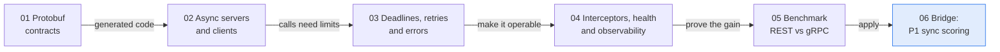

# 🚀 00 - Welcome to gRPC for ML Services

A payment at checkout cannot wait for a slow model. gRPC gives ML services a typed contract, binary messages and a deadline that travels with the call. This course covers what you need to build and operate one in Python.

## 🎯 Objectives
- Choose between gRPC, REST and SSE for a given ML service.
- Design a contract-first API with Protocol Buffers and evolve it safely.
- Build async servers and clients with deadlines, retries and clear errors.
- Run gRPC in production and measure it against REST.

> [!info] Estado 2026
> `grpc.aio` (async) is the standard Python stack, and inference servers such as Triton expose gRPC next to REST. Browsers still use REST or SSE (gRPC-Web and ConnectRPC exist as bridges). `buf` is the common tool for schema linting and breaking-change checks. Verified: 2026-10.

## 🧭 When to use what
| Need | Choose | Why |
|------|--------|-----|
| Service-to-service call with a latency budget | **gRPC** | Typed contract, binary messages, deadlines |
| Public API, quick demos, browser clients | REST + JSON | Easy to call and debug |
| Server pushes tokens to a browser | SSE | One-way stream over plain HTTP (see [[10 - Cloud, Infra y Backend/48 - LLM Token Streaming - SSE, WebSockets and gRPC/04 - SSE vs WebSockets vs gRPC Streaming\|SSE vs WebSockets vs gRPC]]) |

## 📖 Glossary
| Term | Meaning |
|------|---------|
| **RPC** | Remote procedure call: calling a function that runs on another machine |
| **Protocol Buffers** | Binary message format defined in a `.proto` file |
| **Stub** | Generated client object with one method per RPC |
| **Channel** | Long-lived connection a client reuses for many calls |
| **HTTP/2** | Transport that multiplexes many calls on one connection |
| **Unary / streaming** | One request and one response, or a stream in one or both directions |
| **Deadline** | The moment after which the caller no longer wants the answer |
| **Status code** | Typed result such as `OK`, `UNAVAILABLE`, `DEADLINE_EXCEEDED` |
| **Metadata** | Key-value headers sent with a call (auth, trace id) |
| **Interceptor** | Hook that wraps every call (metrics, tracing, auth) |
| **Health check** | Standard RPC that tells a balancer if the service is ready |
| **Reflection** | Lets tools such as `grpcurl` discover the API without the `.proto` |

## 🗺️ The course
| # | Note | You will learn |
|---|------|----------------|
| 01 | Protocol Buffers and Contract-First APIs | Messages, enums, safe evolution, `buf` |
| 02 | Async gRPC Servers and Clients in Python | `grpc.aio`, unary and bidirectional streams, micro-batching |
| 03 | Deadlines, Retries and Error Handling | Deadline propagation, retry policy, keepalive, status codes |
| 04 | Production gRPC | Interceptors, health, reflection, TLS and auth |
| 05 | Benchmarking REST vs gRPC | Open-loop load, p95/p99, how to read the result |
| 06 | Bridge to Project: Synchronous Scoring in P1 | Cheat sheet and the checklist for P1 milestone M7c |

Related: [[10 - Cloud, Infra y Backend/31 - FastAPI for ML/07 - gRPC and Inter-Service Communication|gRPC introduction in FastAPI for ML]] (the short version this course expands).

🛠️ **Applied in:** P1 `realtime-fraud-detection`, milestone M7c: a `Score` call with a 50 ms deadline, a bidirectional `ScoreStream`, and experiment E11 (REST vs gRPC).

➡️ [[10 - Cloud, Infra y Backend/49 - gRPC for ML Services in Python/01 - Protocol Buffers and Contract-First APIs|01 Protocol Buffers]]
