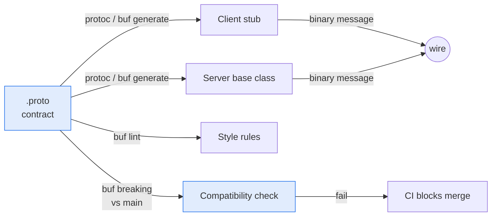

# 📜 01 - Protocol Buffers and Contract-First APIs

In gRPC the `.proto` file is the API. Write it first, generate the code from it, and let tools tell you when a change would break a client.

## 🎯 Objectives
- Write messages, enums and services in a `.proto` file.
- Explain why field numbers, not names, define compatibility.
- Classify a schema change as safe or breaking.
- Lint a contract and detect breaking changes with `buf`.



> [!info] Estado 2026
> proto3 is still the most used syntax. Protobuf **Editions** (`edition = "2023"`) is the newer way to evolve the language, and tools keep supporting both. `buf` v2 (`buf.yaml` with `modules`) is the common linter and breaking-change checker. In Python, `grpcio-tools` generates the code. Verified: 2026-10.

---

## 1. Contract-first
In a contract-first API you write the interface before any code. The contract is the single source of truth, and client and server code are generated from it, so they cannot drift apart.

| | REST + JSON (typical) | gRPC + Protobuf |
|---|---|---|
| Contract | Optional (OpenAPI, often written after the code) | Required (`.proto`) |
| Client code | Hand-written or generated from OpenAPI | Always generated |
| Wire format | Text, field names repeated in every message | Binary, field numbers only |
| Breaking-change check | Rare | `buf breaking` in CI |

Caso real: P1 keeps `proto/fraud/v1/scoring.proto` in the repo from the first day. A test checks that every payment field exists in the request message.

## 2. Messages and field numbers
A message is a typed record. Each field has a **number**, and that number is what travels on the wire.

```protobuf
syntax = "proto3";
package fraud.v1;                       // WHY: version in the package so v2 can live next to v1

message ScoreRequest {
  string payment_id = 1;                // WHY: numbers 1-15 take 1 byte on the wire, so give them to hot fields
  string user_id    = 2;
  double amount     = 4;                // number 3 was removed: see section 5
  string currency   = 5;                // ISO 4217
  Channel channel   = 11;
  optional string coupon = 12;          // WHY: `optional` keeps "not sent" different from ""
  repeated string tags = 13;            // WHY: a list of values
}
```

Each field is stored as a tag plus its value. The tag is one formula:

$$\text{tag} = (\text{field number} \ll 3)\ |\ \text{wire type}$$

Numbers 1 to 15 fit in a one-byte tag, and numbers 16 to 2047 need two bytes.

¡Sorpresa! Names are not on the wire. You can rename a field without breaking old binary clients, but you can **never** change its number or reuse it.

## 3. Types and the proto3 defaults
Every scalar has a default value: `0`, `""`, `false`. A field that equals its default is **not sent**, so the receiver cannot tell "zero" from "missing".

| Problem | Fix |
|---------|-----|
| Need to know if a number or string was set | Use `optional` (adds presence tracking) |
| Money as `double` (rounding errors) | Use integer minor units, such as `int64 amount_minor`, or `google.type.Money` |
| Time | Use `google.protobuf.Timestamp` and `Duration`, not strings or raw integers |
| Either-or data | Use `oneof` so only one field is set |

⚠️ P1 uses `double amount` to match its Python model. For a real payment system, prefer integer minor units. This is a conscious simplification, and you should say so in an interview.

## 4. Enums: always an UNSPECIFIED zero
The first enum value must be zero. Make it `UNSPECIFIED`, so a missing field is never mistaken for a real choice.

```protobuf
enum Decision {
  DECISION_UNSPECIFIED = 0;             // WHY: default for "not set", never a business meaning
  DECISION_APPROVE = 1;
  DECISION_REVIEW  = 2;
  DECISION_BLOCK   = 3;                 // WHY: prefix with the enum name, because enum values share the package scope
}
```

💡 Unknown enum numbers from a newer server arrive as the raw integer in old clients. Handle `UNSPECIFIED` and unknown values with a safe default, such as "send to review".

## 5. Evolving a contract safely
Clients and servers upgrade at different times, so every change must work with the old and the new version.

| Change | Safe? | Note |
|--------|:-----:|------|
| Add a field with a **new** number | ✅ | Old readers ignore it |
| Add an enum value or an RPC | ✅ | Clients must tolerate unknown enum values |
| Rename a field | ⚠️ | Binary is safe. JSON and generated source code break |
| Change a field's type or number | ❌ | Old data is decoded incorrectly |
| Reuse a removed number | ❌ | Old data lands in the wrong field |
| Remove a field without `reserved` | ❌ | Someone may reuse the number later |

```protobuf
message ScoreRequest {
  reserved 3;                           // WHY: the compiler now rejects any new field with number 3
  reserved "old_amount";                // WHY: also blocks the old name
}
```

Caso real: removing a field is allowed, but you write `reserved` in the same change. `buf breaking` catches the cases you forget.

## 6. Tooling: generate, lint, check
```bash
# Generate Python code (grpcio-tools)
python -m grpc_tools.protoc -Iproto --python_out=gen --grpc_python_out=gen proto/fraud/v1/scoring.proto

buf lint                                   # style rules (STANDARD): naming, package versions, enum zero values
buf breaking --against '.git#branch=main' # fails if the change breaks existing clients
```

`buf.yaml` in P1 turns both checks on:

```yaml
version: v2
modules:
  - path: proto
lint:
  use: [STANDARD]
breaking:
  use: [FILE]          # WHY: strictest level, also catches changes that break generated source code
```

⚠️ A change that passes `buf breaking` can still be a **behavior** break. If a field keeps its type but changes its meaning (for example from dollars to cents), no tool will warn you. Add a new field instead.

## 7. Why binary is smaller
For one payment message with 12 fields, JSON needs about 225 bytes and protobuf about 70. Protobuf sends numbers instead of names, and encodes values compactly. Your own data will give a different ratio, so measure it (note 05).

## 8. Landscape 2026
| Format | What it is | Use it when |
|--------|-----------|-------------|
| **Protobuf** | Schema + binary encoding | gRPC and service-to-service APIs |
| JSON Schema / OpenAPI | Schema for JSON | Public REST APIs |
| Avro (+ Schema Registry) | Binary with schema stored apart | Kafka topics (P1 event streams) |
| FlatBuffers | Zero-copy reads | Games and very hot read paths |

---

## 🧠 Cheat Sheet
| Rule | Why |
|------|-----|
| Number = identity of a field | The wire has numbers, not names |
| Never change or reuse a number | Old data would decode into the wrong field |
| `reserved` on removal | The compiler blocks future reuse |
| Enum zero = `UNSPECIFIED` | Missing is not a real value |
| `optional` for presence | Defaults are not sent |
| Package with a version (`fraud.v1`) | A breaking redesign becomes `v2` |
| `buf lint` + `buf breaking` in CI | Compatibility is checked by a tool, not by memory |

## 🎤 Interview Angle
- **Trade-off:** Protobuf gives small, fast, typed messages and safe evolution, but you lose human-readable payloads and need generated code and tooling.
- **30-second answer:** "I write the `.proto` first and generate client and server from it. I never change or reuse field numbers, I reserve removed ones, and `buf breaking` runs in CI against main, so an incompatible change cannot be merged."

## 🔁 Recall
> [!question]- Why can you rename a field but not renumber it?
> The wire carries the number, not the name. Old binary clients still decode the field by number.

> [!question]- Why must the first enum value be `UNSPECIFIED = 0`?
> A field that is not set decodes as zero. If zero were a real choice, a missing value would look like a decision.

> [!question]- How do you tell "amount is 0" from "amount was not sent"?
> Mark the field `optional`, so the message tracks whether it was set.

> [!question]- What does `reserved 3;` do?
> It stops anyone from using number 3 in this message again, so old data cannot land in a new field.

## References
- Protocol Buffers docs: Language Guide (proto3) and "Updating a message type".
- Buf docs: lint rules and breaking-change categories.
- gRPC docs: Python quick start.

⬅️ [[10 - Cloud, Infra y Backend/49 - gRPC for ML Services in Python/00 - Welcome to gRPC for ML Services|00 Welcome]] · ➡️ [[10 - Cloud, Infra y Backend/49 - gRPC for ML Services in Python/02 - Async gRPC Servers and Clients in Python|02 Async servers and clients]] · 🧭 [[10 - Cloud, Infra y Backend/49 - gRPC for ML Services in Python/00 - Welcome to gRPC for ML Services|Course start]] · 🛠️ P1 realtime-fraud-detection M7c (`scoring.proto`)
