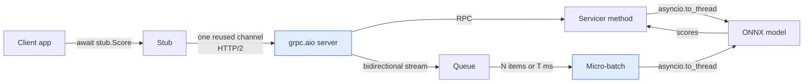

# ⚡ 02 - Async gRPC Servers and Clients in Python

A scoring service spends most of its time waiting for Redis, the network and the model. `grpc.aio` lets one Python process handle thousands of those waits at once, if you follow a few rules.

## 🎯 Objectives
- Build an async gRPC server and client from a generated contract.
- Choose between the four call types: unary and three kinds of streaming.
- Keep the event loop free while a CPU-heavy model runs.
- Group stream messages into micro-batches to use batched inference.



> [!info] Estado 2026
> `grpc.aio` is part of the official `grpcio` package and is the standard way to write async gRPC in Python. The synchronous API (thread pool) still exists. Inference servers such as Triton ship async gRPC clients (`tritonclient.grpc.aio`). Verified: 2026-10.

---

## 1. The four call types
gRPC runs over HTTP/2, so a single call can carry one message or a whole stream, in either direction.

| Type | Client sends | Server sends | Example in ML |
|------|:------------:|:------------:|---------------|
| **Unary** | 1 | 1 | `Score`: one payment, one decision |
| Server streaming | 1 | many | Token-by-token LLM output |
| Client streaming | many | 1 | Upload many events, get one summary |
| **Bidirectional** | many | many | `ScoreStream`: a busy caller sends and receives continuously |

In the `.proto` file the keyword `stream` marks the streaming side: `rpc ScoreStream(stream ScoreRequest) returns (stream ScoreResponse);`.

## 2. An async server
Generate the code (note 01), then subclass the generated servicer base class. Each RPC is an `async def`.

```python
import asyncio, grpc
from fraud.v1 import scoring_pb2 as pb, scoring_pb2_grpc as rpc

class Scoring(rpc.FraudScoringServicer):
    def __init__(self, model):
        self.model = model

    async def Score(self, request: pb.ScoreRequest, context: grpc.aio.ServicerContext):
        features = await load_features(request.card_id)            # WHY: I/O wait; the loop serves other calls meanwhile
        score = await asyncio.to_thread(self.model.score, features) # WHY: CPU work runs in a thread, not on the loop
        return pb.ScoreResponse(payment_id=request.payment_id, score=score)

async def serve() -> None:
    server = grpc.aio.server(maximum_concurrent_rpcs=200)          # WHY: over the limit, new calls fail fast
    rpc.add_FraudScoringServicer_to_server(Scoring(model), server)
    server.add_insecure_port("[::]:50051")
    await server.start()
    try:
        await server.wait_for_termination()
    finally:
        await server.stop(grace=5)                                 # WHY: let running calls finish for 5 s

asyncio.run(serve())
```

¡Sorpresa! A call to `model.score(...)` directly inside `async def` blocks the **whole** event loop. While the model runs, no other RPC is served, and every deadline gets closer. Use `asyncio.to_thread` (ONNX Runtime releases the GIL during inference) or a process pool.

💡 `maximum_concurrent_rpcs` makes the server answer `RESOURCE_EXHAUSTED` when it is full. It is a simple form of the load shedding from [[06 - Large Language Models/19 - LLM Gateway Patterns and LiteLLM/09 - Tail Latency and Overload Control|note 09 of the gateway course]].

## 3. An async client and the reused channel
A **channel** is the long-lived HTTP/2 connection. Create it once, at startup, and reuse it for every call.

```python
channel = grpc.aio.insecure_channel("scoring:50051")        # WHY: created once per process, not per request
stub = rpc.FraudScoringStub(channel)

async def decide(req: pb.ScoreRequest) -> pb.ScoreResponse:
    return await stub.Score(req, timeout=0.05)              # WHY: 50 ms deadline, set on every call

# at shutdown
await channel.close()
```

❌ `async with grpc.aio.insecure_channel(...)` inside the request handler opens a new connection (TCP and HTTP/2 setup) for each call and wipes out the speed gain.
✅ One channel, many concurrent calls: HTTP/2 multiplexes them on the same connection.

⚠️ HTTP/2 limits how many calls can run at once on one connection. For very high load, use a small pool of channels and rotate between them.

## 4. Bidirectional streaming
In a bidirectional stream, the handler receives an async iterator of requests and `yield`s responses. Both sides stay open, so you avoid the cost of a new call for each message.

```python
async def ScoreStream(self, request_iterator, context):
    async for req in request_iterator:                      # WHY: messages arrive over time on the same call
        score = await asyncio.to_thread(self.model.score, to_features(req))
        yield pb.ScoreResponse(payment_id=req.payment_id, score=score)
```

The client side is symmetric: `call = stub.ScoreStream(request_generator())`, then `async for resp in call:`.

⚠️ If the client cancels or the deadline expires, the handler is cancelled with `asyncio.CancelledError`. Release resources in `try/finally`.

## 5. Micro-batching in a stream
Models run faster per item when they score several items together. A **micro-batch** groups messages until it has `N` items or `T` milliseconds have passed, whichever comes first.

```python
async def ScoreStream(self, request_iterator, context):
    queue: asyncio.Queue = asyncio.Queue()

    async def reader():                                      # WHY: reading must continue while we score
        async for req in request_iterator:
            await queue.put(req)
        await queue.put(None)                                # None marks the end of the stream

    task = asyncio.create_task(reader())
    loop, done = asyncio.get_running_loop(), False
    try:
        while not done:
            first = await queue.get()
            if first is None:
                break
            batch, limit = [first], loop.time() + MAX_WAIT   # WHY: the wait starts with the first item
            while len(batch) < MAX_BATCH and (left := limit - loop.time()) > 0:
                try:
                    item = await asyncio.wait_for(queue.get(), left)
                except asyncio.TimeoutError:
                    break
                if item is None:
                    done = True
                    break
                batch.append(item)
            for resp in await asyncio.to_thread(self.model.score_batch, batch):
                yield resp                                   # WHY: one batched call, many responses
    finally:
        task.cancel()
```

The trade-off is fixed: a bigger `MAX_WAIT` gives larger batches and more throughput, but each message can wait up to `MAX_WAIT` longer. Choose it from your latency budget, not from the throughput you want.

Caso real: P1 uses micro-batches in `ScoreStream` so ONNX scores up to `N` payments per call, and experiment E11 (note 05) measures the throughput gain against the added wait.

## 6. Limits worth knowing
| Setting | Default idea | Why change it |
|---------|--------------|---------------|
| Max message size | About 4 MB on receive | Large batches or embeddings can exceed it (`grpc.max_receive_message_length`) |
| `maximum_concurrent_rpcs` | Unlimited | Protects the server under overload |
| Graceful stop `grace` | Set it explicitly | Lets in-flight calls finish during a deploy |

## 7. Landscape 2026
| Option | What it is | Use it when |
|--------|-----------|-------------|
| `grpc.aio` | Official async API | Default choice for async services |
| `grpc` (sync) | Thread-pool server | Simple services with blocking libraries |
| `grpclib` | Pure-Python async implementation | You need a different dependency profile |
| `tritonclient.grpc.aio` | Async client for Triton | You call a Triton inference server |

---

## 🧠 Cheat Sheet
| Topic | Rule | Failure it prevents |
|-------|------|---------------------|
| Server | `grpc.aio.server`, `async def` methods | Thread-per-call overhead |
| CPU work | `asyncio.to_thread` or process pool | Blocked event loop, missed deadlines |
| Channel | One per process, reused | Connection setup on every call |
| Deadline | `timeout=` on every call | Calls that wait forever |
| Streaming | Reader task + queue; `finally` cleanup | Leaked tasks after cancel |
| Micro-batch | `N` items or `T` ms | Slow single-item inference, or unbounded wait |
| Overload | `maximum_concurrent_rpcs` | A full server that gets slower for everyone |

## 🎤 Interview Angle
- **Trade-off:** micro-batching raises throughput and adds up to `T` ms of latency per message. Pick `T` from the latency budget.
- **30-second answer:** "I use `grpc.aio` with one reused channel per process. I never run the model on the event loop, I use `to_thread`. For high-volume callers I use a bidirectional stream with micro-batches of N items or T milliseconds, and `maximum_concurrent_rpcs` makes the server reject work it cannot finish."

## 🔁 Recall
> [!question]- Why must model inference not run directly inside an `async def` handler?
> It blocks the event loop, so no other RPC is served and every pending deadline gets closer. Use `asyncio.to_thread` or a process pool.

> [!question]- Why create the channel once?
> A channel is a long-lived HTTP/2 connection that multiplexes many calls. A new channel per request pays the connection setup every time.

> [!question]- What does a micro-batch limit by `N` and by `T` mean?
> The batch is sent when it has `N` items or when `T` milliseconds have passed since the first item, whichever happens first.

> [!question]- What happens to a streaming handler when the client cancels?
> The handler coroutine is cancelled. Use `try/finally` to cancel helper tasks and free resources.

## References
- gRPC docs: Python Asyncio API (`grpc.aio`) and the basics tutorial.
- grpc.io: "Core concepts" (the four call types).
- ONNX Runtime docs: threading and batching.

⬅️ [[10 - Cloud, Infra y Backend/49 - gRPC for ML Services in Python/01 - Protocol Buffers and Contract-First APIs|01 Protocol Buffers]] · ➡️ [[10 - Cloud, Infra y Backend/49 - gRPC for ML Services in Python/03 - Deadlines, Retries and Error Handling|03 Deadlines and retries]] · 🧭 [[10 - Cloud, Infra y Backend/49 - gRPC for ML Services in Python/00 - Welcome to gRPC for ML Services|Course start]] · 🛠️ P1 realtime-fraud-detection M7c (`grpc.aio` server and `ScoreStream`)
