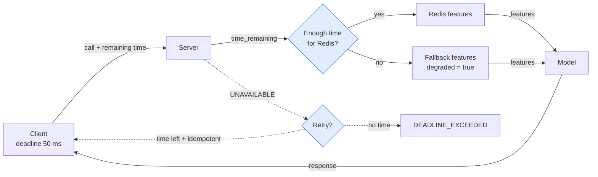

# ⏳ 03 - Deadlines, Retries and Error Handling

A call without a deadline can wait forever, and a retry without a budget can make an outage worse. This note shows how to set time limits, retry only what is safe, and return errors that clients can act on.

## 🎯 Objectives
- Set a deadline on every call and pass the remaining time to downstream calls.
- Answer with a degraded result when time is almost over.
- Configure retries in the service config and know which status codes are safe to retry.
- Return typed errors instead of generic exceptions.



> [!info] Estado 2026
> Retries are built into gRPC through the **service config** (a JSON policy on the channel), so you do not need a wrapper library. In Python, deadlines are **not** passed to downstream calls automatically, so your code must forward the remaining time. Check the gRPC keepalive documentation before tuning keepalive on a server you do not control. Verified: 2026-10.

---

## 1. Deadlines, not timeouts
A **timeout** says "wait up to 50 ms from now". A **deadline** says "I will not accept an answer after this moment". In Python you pass `timeout=` and gRPC turns it into a deadline that travels to the server.

```python
resp = await stub.Score(req, timeout=0.05)     # WHY: 50 ms budget; without it the call may wait forever
```

¡Sorpresa! The default is **no deadline**. A forgotten `timeout=` is a bug that appears only when a dependency is slow.

When a deadline expires, the client receives `DEADLINE_EXCEEDED` and the server handler is cancelled. The server can also read the time left:

$$t_{\text{left}} = \text{deadline} - \text{now}$$

## 2. Use the remaining time inside the server
Each step of the work consumes part of the budget. Check what is left **before** an expensive step, and choose a cheaper path when it is too small.

```python
async def Score(self, request, context):
    left = context.time_remaining()                       # WHY: seconds until the caller's deadline
    degraded = False
    if left is not None and left < 0.015:                 # WHY: Redis p99 is about 12 ms, not enough time
        features, degraded = fallback_features(request), True
    else:
        features = await load_features(request.card_id, timeout=left * 0.5)  # WHY: leave half for the model
    score = await asyncio.to_thread(self.model.score, features)
    return pb.ScoreResponse(payment_id=request.payment_id, score=score, degraded=degraded)
```

The `degraded` flag in the response lets the caller know the answer used backup features. A degraded answer inside the deadline is usually better than an exact answer that arrives too late.

💡 When this server calls another gRPC service, pass `timeout=context.time_remaining()` minus a small margin. Without it, the second call may keep working after the first caller has already given up.

Caso real: in P1, the checkout allows 50 ms. If Redis is slow, the scorer answers with `degraded=true` instead of returning `DEADLINE_EXCEEDED`.

## 3. Status codes and what to do with them
Every call ends with a status code. The client's reaction depends on it.

| Code | Meaning | Retry? |
|------|---------|:------:|
| `OK` | Success | n/a |
| `INVALID_ARGUMENT` | The request is wrong | ❌ Fix the request |
| `UNAUTHENTICATED` / `PERMISSION_DENIED` | Missing or insufficient credentials | ❌ |
| `NOT_FOUND` | The item does not exist | ❌ |
| `DEADLINE_EXCEEDED` | Time ran out | ⚠️ Rarely: no time is left |
| `RESOURCE_EXHAUSTED` | Overloaded or quota hit | ⚠️ Only with backoff |
| `UNAVAILABLE` | Server down or connection lost | ✅ Transient |
| `INTERNAL` / `UNKNOWN` | Bug on the server | ❌ Usually |

## 4. Return typed errors
Use `context.abort` with a status code and a clear message. Do not raise a generic `Exception`: gRPC turns it into `UNKNOWN`, and the client cannot decide what to do.

```python
async def Score(self, request, context):
    if request.amount <= 0:
        await context.abort(grpc.StatusCode.INVALID_ARGUMENT, "amount must be greater than 0")  # WHY: client sees a typed, non-retryable error
    ...
```

On the client side:

```python
try:
    resp = await stub.Score(req, timeout=0.05)
except grpc.aio.AioRpcError as e:
    if e.code() == grpc.StatusCode.DEADLINE_EXCEEDED:
        return fallback_decision(req)                      # WHY: the business has a plan for a late answer
    raise                                                   # WHY: unknown errors must not be hidden
```

💡 For structured details (field name, reason), the `grpcio-status` package lets you attach a `google.rpc.Status` with details to the error.

## 5. Retries with the service config
Configure retries once on the channel, as JSON. gRPC then retries matching failures with exponential backoff.

```python
import json

service_config = {
    "methodConfig": [{
        "name": [{"service": "fraud.v1.FraudScoring", "method": "Score"}],
        "retryPolicy": {
            "maxAttempts": 3,                                # WHY: counts the first call too
            "initialBackoff": "0.005s", "maxBackoff": "0.02s", "backoffMultiplier": 2,
            "retryableStatusCodes": ["UNAVAILABLE"],        # WHY: only the transient code
        },
    }]
}
channel = grpc.aio.insecure_channel("scoring:50051", options=[
    ("grpc.enable_retries", 1),
    ("grpc.service_config", json.dumps(service_config)),
])
```

Three rules keep retries safe:
- **The deadline covers all attempts.** If the first attempt and the backoff use 30 ms of a 50 ms budget, the second attempt has only 20 ms.
- **Retry only idempotent calls.** `Score` is safe to repeat for the same `payment_id`. A call that moves money is not, unless it carries an idempotency key.
- **Add a retry limit for the whole service** (`retryThrottling` in the service config), so a failing backend is not flooded by retries from every client.

⚠️ Retrying `DEADLINE_EXCEEDED` rarely helps: the time is already gone. Retrying `RESOURCE_EXHAUSTED` without backoff makes overload worse (see [[06 - Large Language Models/19 - LLM Gateway Patterns and LiteLLM/09 - Tail Latency and Overload Control|tail latency and overload control]]).

## 6. Keepalive: detect dead connections
A connection can break silently, for example when a load balancer drops it. Keepalive pings find this early, so the next call does not wait for a timeout.

```python
options = [
    ("grpc.keepalive_time_ms", 30_000),              # WHY: ping after 30 s without traffic
    ("grpc.keepalive_timeout_ms", 5_000),            # WHY: if no answer in 5 s, treat the connection as dead
    ("grpc.keepalive_permit_without_calls", 1),      # WHY: also ping when no call is active
]
```

⚠️ The server must **allow** pings at that rate. A client that pings too often can receive a `GOAWAY` with "too_many_pings" and lose the connection. Match the client and server settings.

---

## 🧠 Cheat Sheet
| Topic | Rule | Failure it prevents |
|-------|------|---------------------|
| Deadline | `timeout=` on **every** call | Waiting forever |
| Remaining time | `context.time_remaining()` before costly steps | Late answers from a late dependency |
| Downstream calls | Forward remaining time minus a margin | Work after the caller left |
| Degraded answer | Backup features plus `degraded=true` | `DEADLINE_EXCEEDED` at checkout |
| Retry codes | `UNAVAILABLE` only (by default) | Retry storms, repeated bad requests |
| Retry budget | Deadline spans all attempts | Retries that cannot finish |
| Typed errors | `context.abort(code, message)` | Everything becoming `UNKNOWN` |
| Keepalive | Matched client and server settings | Silent dead connections, `GOAWAY` |

## 🎤 Interview Angle
- **Trade-off:** a degraded answer protects latency and loses accuracy. Retries improve success and risk load. Both need a limit.
- **30-second answer:** "Every call has a deadline. The server checks the time left, and if Redis cannot answer in time it uses fallback features and flags the answer as degraded. Retries are configured in the service config for `UNAVAILABLE` only, on idempotent calls, inside the same deadline."

## 🔁 Recall
> [!question]- What is the difference between a timeout and a deadline?
> A timeout is a duration from now. A deadline is a fixed moment that travels with the call, so every hop knows how much time is left.

> [!question]- Why can `DEADLINE_EXCEEDED` be a poor candidate for retry?
> The time budget is already used up, so a second attempt has no time to finish.

> [!question]- Why must retried calls be idempotent?
> The first attempt may have reached the server before the connection failed. A repeat must not apply the same action twice.

> [!question]- How does the server know how much time is left?
> `context.time_remaining()` returns the seconds until the caller's deadline.

## References
- gRPC docs: "Deadlines" and "Status codes and their use in gRPC".
- gRPC docs: "Retries" and the service config (`retryPolicy`, `retryThrottling`).
- gRPC docs: "Keepalive".

⬅️ [[10 - Cloud, Infra y Backend/49 - gRPC for ML Services in Python/02 - Async gRPC Servers and Clients in Python|02 Async servers and clients]] · ➡️ [[10 - Cloud, Infra y Backend/49 - gRPC for ML Services in Python/04 - Production gRPC - Interceptors, Health and Observability|04 Production gRPC]] · 🧭 [[10 - Cloud, Infra y Backend/49 - gRPC for ML Services in Python/00 - Welcome to gRPC for ML Services|Course start]] · 🛠️ P1 realtime-fraud-detection M7c (50 ms deadline, `degraded`)
