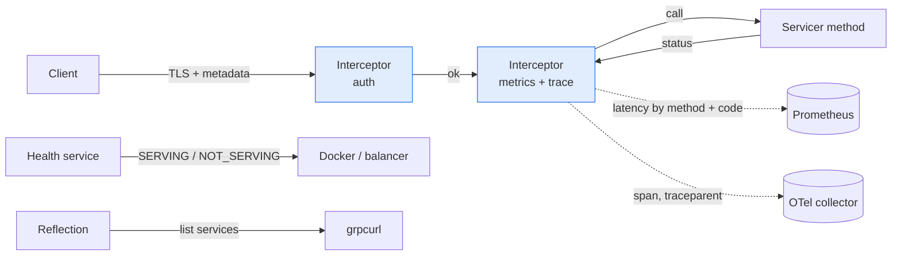

# 🛡️ 04 - Production gRPC - Interceptors, Health and Observability

A gRPC service that works on your laptop is not ready for production. It also needs metrics and traces, a health endpoint for the orchestrator, authentication, and a way to inspect it without the `.proto` file.

## 🎯 Objectives
- Add cross-cutting behavior (metrics, auth, tracing) with interceptors.
- Expose health checking and server reflection, and use them with `grpcurl`.
- Secure a service with TLS and authentication by metadata.
- Explain why a plain layer-4 load balancer breaks gRPC load distribution.



> [!info] Estado 2026
> The standard packages are `grpcio-health-checking` (health service), `grpcio-reflection` (reflection) and `opentelemetry-instrumentation-grpc` (traces and metrics interceptors for sync and async servers). `grpcurl` is the usual command-line client. Some `grpc.aio` context methods, such as `context.code()`, are still marked experimental in the docs. Verified: 2026-10.

---

## 1. Interceptors
An **interceptor** wraps every call. It is the right place for **cross-cutting concerns**: things that every method needs, such as metrics, authentication and logging. The handler code stays clean.

In Python's `grpc.aio`, a server interceptor receives the next step (`continuation`) and the call details, and returns a handler. To observe a unary-unary method, you wrap its behavior:

```python
import time, grpc
from prometheus_client import Histogram

LAT = Histogram("grpc_server_latency_seconds", "RPC latency", ["method", "code"])

class MetricsInterceptor(grpc.aio.ServerInterceptor):
    async def intercept_service(self, continuation, details):
        handler = await continuation(details)                  # WHY: the real handler for this method
        if handler is None or not handler.unary_unary:
            return handler                                     # WHY: this sketch wraps unary calls only
        inner, method = handler.unary_unary, details.method

        async def wrapped(request, context):
            t0 = time.perf_counter()
            try:
                return await inner(request, context)
            finally:
                code = context.code() or grpc.StatusCode.OK    # WHY: abort() sets the code before it raises
                LAT.labels(method, code.name).observe(time.perf_counter() - t0)

        return grpc.unary_unary_rpc_method_handler(
            wrapped, request_deserializer=handler.request_deserializer,
            response_serializer=handler.response_serializer)

server = grpc.aio.server(interceptors=[MetricsInterceptor()])
```

⚠️ Each call type (unary, server stream, client stream, bidirectional) needs its own wrapper. In practice, use the OpenTelemetry instrumentation for traces and metrics, and write only the interceptors that are specific to your service.

💡 Interceptors run **in order**: put authentication first, so rejected calls skip the rest of the work.

## 2. Observability: what to measure
Measure the same four signals for every method:

| Signal | How | Why |
|--------|-----|-----|
| Rate | Counter of calls by method | Traffic and sudden drops |
| Errors | Calls by status code | `UNAVAILABLE` and `INTERNAL` rising means trouble |
| Latency | Histogram by method and code | p95 and p99, not the mean |
| In flight | Gauge of active calls | Saturation before failures |

**Traces:** the trace context travels in the call metadata (the `traceparent` header). The OpenTelemetry interceptor reads it on the server and continues the same trace, so one request shows up as one trace across services.

⚠️ Keep metric labels small. `method` and `code` are fine. A label such as `user_id` creates millions of time series.

## 3. Health checking
Orchestrators and load balancers need a standard way to ask "can I send traffic here?". gRPC defines the `grpc.health.v1.Health` service for this.

```python
from grpc_health.v1 import health, health_pb2, health_pb2_grpc

health_servicer = health.aio.HealthServicer()
health_pb2_grpc.add_HealthServicer_to_server(health_servicer, server)

await health_servicer.set("fraud.v1.FraudScoring", health_pb2.HealthCheckResponse.SERVING)   # WHY: after the model is loaded

# at shutdown, before server.stop():
await health_servicer.set("fraud.v1.FraudScoring", health_pb2.HealthCheckResponse.NOT_SERVING)  # WHY: balancer drains traffic first
```

Docker can use the `grpc_health_probe` binary in a healthcheck:
`grpc_health_probe -addr=localhost:50051 -service=fraud.v1.FraudScoring`.

💡 Report `SERVING` only after the model is loaded and Redis is reachable. A process that is running but not ready should answer `NOT_SERVING`.

## 4. Reflection and grpcurl
**Reflection** lets a tool ask the server what services and methods it has, so you can call it without the `.proto` file.

```python
from grpc_reflection.v1alpha import reflection

reflection.enable_server_reflection(
    (pb.DESCRIPTOR.services_by_name["FraudScoring"].full_name, reflection.SERVICE_NAME), server)
```

```bash
grpcurl -plaintext localhost:50051 list                                      # services on the server
grpcurl -plaintext localhost:50051 describe fraud.v1.FraudScoring            # methods and messages
grpcurl -plaintext -d '{"payment_id":"p1","amount":42.5,"currency":"USD"}' \
  localhost:50051 fraud.v1.FraudScoring/Score                                # one call, JSON in and out
```

⚠️ Reflection exposes your API surface. Enable it in development and on internal networks, and disable it on anything public.

## 5. TLS and authentication
```python
creds = grpc.ssl_server_credentials([(private_key, certificate_chain)])
server.add_secure_port("[::]:50051", creds)               # WHY: encrypted transport; also required before sending credentials

channel = grpc.aio.secure_channel("scoring:50051", grpc.ssl_channel_credentials(root_certificates=ca_pem))
```

**Authentication by metadata:** the client sends a token in a header, and an interceptor checks it before the handler runs.

```python
import hmac

class AuthInterceptor(grpc.aio.ServerInterceptor):
    async def intercept_service(self, continuation, details):
        meta = dict(details.invocation_metadata)
        if not hmac.compare_digest(meta.get("x-api-key", ""), API_KEY):   # WHY: constant-time comparison
            async def deny(request, context):
                await context.abort(grpc.StatusCode.UNAUTHENTICATED, "invalid api key")
            return grpc.unary_unary_rpc_method_handler(deny)
        return await continuation(details)
```

Use mutual TLS (both sides present certificates) when the clients are other services you control. A local self-signed certificate is enough for P1.

## 6. Load balancing: the long-lived connection problem
A gRPC channel keeps one HTTP/2 connection open for a long time and sends many calls through it. A **layer-4** (TCP) balancer chooses a server **once**, when the connection opens. Every call on that channel then goes to the same server.

¡Sorpresa! You can have 4 healthy servers behind a layer-4 balancer and see 100% of the traffic on one of them.

| Option | How it spreads calls |
|--------|----------------------|
| Layer-7 proxy (Envoy, Nginx with gRPC) | Balances each call across servers |
| Client-side balancing (`round_robin` policy plus DNS) | The client opens a connection to each server |
| Several channels from the client | Rough spread, no health awareness |

---

## 🧠 Cheat Sheet
| Need | Tool | Detail |
|------|------|--------|
| Metrics, tracing, auth | Interceptors | Auth first; one wrapper per call type |
| Golden signals | Prometheus histogram | Labels: `method`, `code` only |
| Traces across services | OpenTelemetry | `traceparent` in metadata |
| Ready for traffic? | `grpc.health.v1` | `NOT_SERVING` before shutdown |
| Debug without `.proto` | Reflection + `grpcurl` | Dev and internal only |
| Encryption | TLS (mutual TLS between services) | Credentials only over TLS |
| Even load | L7 proxy or client-side `round_robin` | L4 pins a channel to one server |

## 🎤 Interview Angle
- **Trade-off:** interceptors keep handlers clean but add work on every call, so keep them light and measure their cost.
- **30-second answer:** "I add interceptors for authentication, metrics and tracing. The health service reports `SERVING` only after the model loads and goes to `NOT_SERVING` before shutdown. Reflection and `grpcurl` help debug. I use TLS, and I balance at layer 7 or on the client, because a layer-4 balancer pins each long-lived connection to one server."

## 🔁 Recall
> [!question]- Why put the authentication interceptor first?
> Rejected calls then skip every later step, so unauthenticated traffic costs almost nothing.

> [!question]- Why should the service report `NOT_SERVING` before it stops?
> The balancer or orchestrator stops sending new calls, and the running calls can finish during the grace period.

> [!question]- Why is a layer-4 balancer a problem for gRPC?
> It picks a server once per connection. One gRPC channel is one long connection, so all its calls go to the same server.

> [!question]- Why avoid a `user_id` label in metrics?
> Each value creates a new time series. Millions of series overload the metrics system.

## References
- gRPC docs: "Health Checking", "Interceptors" and "Auth".
- OpenTelemetry Python docs: gRPC instrumentation.
- `grpcurl` README (list, describe and call).

⬅️ [[10 - Cloud, Infra y Backend/49 - gRPC for ML Services in Python/03 - Deadlines, Retries and Error Handling|03 Deadlines and retries]] · ➡️ [[10 - Cloud, Infra y Backend/49 - gRPC for ML Services in Python/05 - Benchmarking REST vs gRPC|05 Benchmarking]] · 🧭 [[10 - Cloud, Infra y Backend/49 - gRPC for ML Services in Python/00 - Welcome to gRPC for ML Services|Course start]] · 🛠️ P1 realtime-fraud-detection M7c (interceptors, health, reflection)
