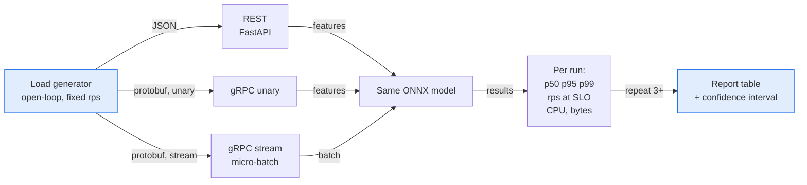

# 📏 05 - Benchmarking REST vs gRPC

"gRPC is faster" is a claim, not a result. This note shows how to measure it fairly, and how to read the answer when the model, not the protocol, takes most of the time.

## 🎯 Objectives
- Estimate how much a protocol change can improve a service before you measure.
- Explain open-loop load and why closed-loop tests hide latency.
- Design a fair comparison: same model, same machine, warm-up, repeated runs.
- Decide with a confidence interval whether a difference is real.



> [!info] Estado 2026
> `ghz` is the standard load tool for gRPC. `k6` drives REST and also has native gRPC support. Both can send load at a fixed arrival rate (open-loop), which is the mode you want for latency tests. Verified: 2026-10.

---

## 1. Estimate the gain first
A protocol change only speeds up the part of the request that the protocol controls: connection handling and serialization. The model time stays the same.

$$\text{max gain} = \frac{t_{\text{REST overhead}} - t_{\text{gRPC overhead}}}{t_{\text{REST total}}}$$

Example: inference takes 20 ms, REST overhead is 4 ms and gRPC overhead is 1.5 ms. REST total is 24 ms, gRPC total is 21.5 ms. The best-case gain is 2.5 / 24, about 10%.

💡 If inference is 90% of the request, do not expect gRPC to change the picture. That is a valid and honest result to publish.

Caso real: P1 compares REST, gRPC unary and gRPC streaming on the same ONNX model (experiment E11). The plan accepts "no big difference" as a result, as long as the method is clear.

## 2. Open-loop vs closed-loop load
Two ways to generate load give different answers.

| | Closed-loop | Open-loop |
|---|---|---|
| Rule | Each virtual user sends the next request after the previous one returns | Requests arrive at a fixed rate, no matter what |
| When the server slows down | The load generator also slows down | Requests keep arriving and queue up |
| What you see | Flattering latencies | The latency a real user would see |

¡Sorpresa! This effect is called **coordinated omission**. In a closed-loop test, a 2-second stall delays the next requests, so only a few slow samples are recorded. In reality, hundreds of requests would have waited. The test hides the exact problem you want to find.

Use **open-loop** for every latency comparison. Closed-loop is fine for a quick maximum-throughput check.

## 3. The tools
```bash
# gRPC unary: fixed 500 requests per second for 60 s, 4 connections
ghz --insecure --proto proto/fraud/v1/scoring.proto --import-paths proto \
    --call fraud.v1.FraudScoring.Score -D payment.json \
    --rps 500 -z 60s --connections 4 localhost:50051
```

```javascript
// k6 REST, open-loop: constant arrival rate, independent of response time
export const options = {
  scenarios: { rest: {
    executor: 'constant-arrival-rate', rate: 500, timeUnit: '1s',
    duration: '60s', preAllocatedVUs: 100,          // enough users to keep the rate even if calls are slow
  } },
};
```

⚠️ On a laptop, the load generator and the service share the same CPU. Keep the generator light, limit CPU use for both, and note the hardware in the report. A saturated generator measures itself.

## 4. A fair comparison
Hold everything constant except the protocol:

| Control | Why |
|---------|-----|
| Same model file, same machine, same Redis data | Only the protocol changes |
| Same payload content | Message size affects serialization |
| Warm-up of 10-30 s, not measured | Caches, JIT and connection pools reach a steady state |
| Same rate for each variant, then a rate sweep | Compare at equal load, then find the limit |
| 3 or more runs per variant | Measures run-to-run variance |
| Record versions and settings | Anyone can repeat the experiment |

Measure these for each run:

| Metric | Meaning |
|--------|---------|
| p50, p95, p99 latency | Typical and tail latency |
| **Capacity at SLO** | Highest rate where p99 stays under the budget (for P1: 50 ms) |
| Bytes per request | Network cost of serialization |
| CPU per request | Cost of the protocol on the server |
| Error rate | Calls that failed or timed out |

The **headline number** is capacity at SLO: "variant X sustains N requests per second with p99 under 50 ms."

## 5. Is the difference real?
Two runs never give identical numbers. Before claiming a winner, check that the difference is larger than the noise. A simple way is a bootstrap confidence interval for the p99 difference.

```python
import numpy as np

rng = np.random.default_rng(0)

def p99_diff_ci(a_ms, b_ms, n=2000):
    """95% interval for p99(a) - p99(b), resampling the latency samples."""
    diffs = []
    for _ in range(n):
        a = rng.choice(a_ms, len(a_ms))                  # WHY: resample with replacement
        b = rng.choice(b_ms, len(b_ms))
        diffs.append(np.percentile(a, 99) - np.percentile(b, 99))
    return np.percentile(diffs, [2.5, 97.5])

lo, hi = p99_diff_ci(rest_ms, grpc_ms)
# interval contains 0 -> no proven difference: report parity
# interval fully above 0 -> REST p99 is higher; report the size of the gap
```

⚠️ Report the interval, not only the median. A 3 ms gap with an interval of ±5 ms is not a result.

## 6. Reading the result
| What you see | Likely reason | What to write |
|--------------|---------------|---------------|
| gRPC lower p99 by a clear margin | Cheaper serialization and no per-request connection cost | The gain and its interval |
| Almost no difference | Inference dominates the time | "Parity: inference is N% of latency" |
| Streaming: higher throughput, higher p50 | Micro-batch wait adds delay, batches use the model better | The trade-off with the batch size |
| REST wins in one case | Small payloads, warm connections, or a poor gRPC setup (channel per request) | Check the setup before publishing |

💡 Look at CPU and bytes as well. A protocol that gives the same latency with 30% less CPU still has value.

## 7. Landscape 2026
| Tool | What it is | Use it when |
|------|-----------|-------------|
| `ghz` | Load tester for gRPC | Unary and streaming gRPC at a fixed rate |
| `k6` | Scriptable load tester with HTTP and gRPC | One tool for both protocols, open-loop executors |
| `wrk2` | HTTP load tool built to avoid coordinated omission | Simple REST latency tests |
| Locust | Python load tester | Complex user flows, closed-loop by default |

---

## 🧠 Cheat Sheet
| Step | Rule | Mistake it prevents |
|------|------|---------------------|
| Estimate | Gain ≤ protocol overhead / total time | Expecting miracles when inference dominates |
| Load | Open-loop, fixed arrival rate | Coordinated omission |
| Control | Same model, data, payload, machine | Unfair comparison |
| Run | Warm-up, 3+ repeats | Cold-start and noise |
| Measure | p95/p99, capacity at SLO, CPU, bytes | Looking only at averages |
| Decide | Confidence interval of the difference | Calling noise a result |
| Report | Method, versions, hardware, honest "parity" | Results nobody can repeat |

## 🎤 Interview Angle
- **Trade-off:** a faster protocol helps only the part of latency that the protocol controls. Streaming raises throughput and adds batch wait.
- **30-second answer:** "I estimated the best-case gain first, then ran an open-loop test at a fixed arrival rate with `ghz` and `k6`, same model and machine, warm-up and three repeats. I compared p99 and capacity at the 50 ms SLO with a bootstrap interval. If inference dominates, I report parity with the numbers."

## 🔁 Recall
> [!question]- Why use an open-loop test for latency?
> Requests arrive at a fixed rate even when the server is slow, so queueing shows up in the latency. A closed-loop test slows down with the server and hides the problem.

> [!question]- What is coordinated omission?
> A measurement error where the load generator waits for slow responses and therefore sends fewer requests during the slow period, so the slow period is under-represented.

> [!question]- If inference is 90% of the request, what gain can a protocol change give?
> At most the share of the remaining 10% that the change removes, so the end-to-end gain is small.

> [!question]- What is "capacity at SLO"?
> The highest request rate at which the p99 latency stays under the agreed budget.

## References
- `ghz` documentation (options for rate, duration and connections).
- Grafana k6 docs: "Open and closed models" and the `constant-arrival-rate` executor.
- Gil Tene, "How NOT to Measure Latency" (talk on coordinated omission).

⬅️ [[10 - Cloud, Infra y Backend/49 - gRPC for ML Services in Python/04 - Production gRPC - Interceptors, Health and Observability|04 Production gRPC]] · ➡️ [[10 - Cloud, Infra y Backend/49 - gRPC for ML Services in Python/06 - Bridge to Project - Synchronous Scoring in P1|06 Bridge to P1]] · 🧭 [[10 - Cloud, Infra y Backend/49 - gRPC for ML Services in Python/00 - Welcome to gRPC for ML Services|Course start]] · 🛠️ P1 realtime-fraud-detection M7c (experiment E11)
