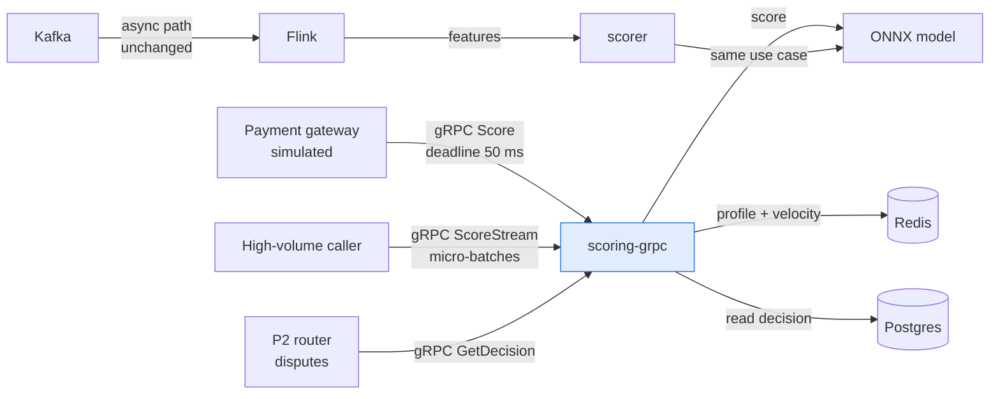

# 🌉 06 - Bridge to Project - Synchronous Scoring in P1

You now have the pieces: contract, async server, deadlines, production features and a fair benchmark. This note maps each piece to milestone M7c of `realtime-fraud-detection` and lists what to prove in the repo.

## 🎯 Objectives
- Place gRPC next to the Kafka path in the P1 architecture.
- Map each course note to a concrete decision in the project.
- Check the acceptance criteria of milestone M7c.
- Run experiment E11 and report it honestly.



> [!info] Estado 2026
> P1 already has the contract in the repo (`proto/fraud/v1/scoring.proto`, `buf.yaml`, `tests/test_proto_contract.py`). The server, client, interceptors and experiment E11 are not built yet: they belong to milestone M7c, which comes after M4 (the first honest CV number). Verified: 2026-10.

---

## 1. What P1 adds
Fraud scoring already runs through Kafka and Flink. That path is asynchronous. A card payment at checkout needs a **synchronous** decision inside a deadline, and gRPC is the transport for it.

| RPC | Type | Caller | Purpose |
|-----|------|--------|---------|
| `Score` | Unary | Payment gateway | One payment, one decision, 50 ms deadline |
| `ScoreStream` | Bidirectional | High-volume caller | Many payments on one call, scored in micro-batches |
| `GetDecision` | Unary | P2 router | Read the decision the async path already made |

The server is a second **entrypoint** of the scorer service, built from the same image and the same `score_sync` use case. Features and model adapter are shared with the Kafka path, so the two paths cannot drift apart (no train/serve skew).

## 2. Course map to project decisions
| Note | Decision in P1 |
|------|----------------|
| 01 Protobuf | `scoring.proto` is the source of truth; `reserved` on removals; `buf lint` and `buf breaking` run in CI |
| 02 Async servers | `grpc.aio` server; model runs with `asyncio.to_thread`; one channel per client process; `ScoreStream` uses micro-batches of N items or T ms |
| 03 Deadlines | Client deadline 50 ms; the server checks `time_remaining()`, falls back to default features and sets `degraded=true`; retries only `UNAVAILABLE` |
| 04 Production | Interceptors for metrics and traces; health service; reflection for `grpcurl`; API key in metadata; optional local TLS |
| 05 Benchmarking | Experiment E11: open-loop `ghz` vs `k6`, same model, 3 or more runs, confidence interval |

## 3. Milestone M7c
| Item | Value |
|------|-------|
| Position | After M4 (needs the first measured numbers and a working scorer) |
| Size | M (medium) |
| Deliverables | Server, client with deadlines, health, reflection, interceptors, `buf` in CI, experiment E11 |
| Acceptance | `grpcurl` calls all 3 methods. An expired deadline returns `DEADLINE_EXCEEDED` (automated test). The REST vs gRPC table is published |

The deadline test is short and belongs in the repo from the first day of the milestone:

```python
async def test_expired_deadline_returns_deadline_exceeded(stub, payment):
    with pytest.raises(grpc.aio.AioRpcError) as err:
        await stub.Score(payment, timeout=0.0001)           # WHY: no server can answer in 0.1 ms
    assert err.value.code() == grpc.StatusCode.DEADLINE_EXCEEDED
```

## 4. Checklist: what to prove in the repo
- [ ] `proto/fraud/v1/scoring.proto` has 3 RPCs, an `UNSPECIFIED` enum zero, and `reserved` on every removed field.
- [ ] CI runs `buf lint` and `buf breaking --against '.git#branch=main'`.
- [ ] The `grpc.aio` server shares `score_sync` with the Kafka path (one use case, two entrypoints).
- [ ] The model never runs on the event loop (`to_thread` or process pool), and a test shows other calls still answer during inference.
- [ ] The client reuses one channel and sets `timeout=` on every call.
- [ ] With Redis slowed down, the server answers `degraded=true` inside the deadline (chaos test).
- [ ] Retries are configured for `UNAVAILABLE` only.
- [ ] Health reports `NOT_SERVING` before shutdown; `grpcurl list` works through reflection.
- [ ] Metrics have only `method` and `code` labels; traces continue across the call.
- [ ] Experiment E11 is in `docs/` with method, hardware, versions, raw results and the interval.
- [ ] The README names gRPC in the plain "Key technologies at a glance" line and links the E11 table.

## 5. Experiment E11
| Variant | What changes | Report |
|---------|--------------|--------|
| REST + JSON (FastAPI) | Baseline | p50, p95, p99, capacity at 50 ms SLO, bytes, CPU |
| gRPC unary | Protocol only | Same metrics |
| gRPC bidirectional stream | Micro-batch size (for example 1, 8, 32) | Same metrics, plus added batch wait |

Rules: same model, same machine, warm-up, 3 or more runs, open-loop load. Publish the result you get. If the difference is inside the margin of error, the honest title is "parity: inference dominates".

## 6. Mistakes that would cost you the experiment
| Mistake | Effect |
|---------|--------|
| New channel per request | gRPC looks slower than REST for the wrong reason |
| Model on the event loop | Every deadline fails under load |
| Closed-loop test | Latency looks better than reality |
| No `timeout=` on the client | A slow dependency freezes the caller |
| Load generator on the same busy CPU | You measure the generator |

---

## 🧠 Cheat Sheet (whole course)
| Layer | Rule |
|-------|------|
| Contract | Numbers are identity; never reuse; `reserved`; `buf` in CI |
| Server | `grpc.aio`; `to_thread` for the model; micro-batch by N or T |
| Client | One channel; `timeout=` on every call |
| Time | Deadline travels; check `time_remaining()`; degrade instead of failing |
| Retries | `UNAVAILABLE` only; idempotent calls; one deadline for all attempts |
| Production | Interceptors, health, reflection, TLS, L7 or client-side balancing |
| Proof | Open-loop, equal conditions, repeats, interval, honest parity |

## 🎤 Interview Angle
- **Trade-off:** gRPC adds contract tooling and operational pieces (balancing, reflection, health) in exchange for typed, low-overhead, deadline-aware calls.
- **30-second answer:** "P1 keeps the Kafka path for stream scoring and adds gRPC for checkout decisions: a unary `Score` with a 50 ms deadline and a degraded fallback, a bidirectional stream with micro-batches, and CI checks with `buf`. I benchmarked it against REST with an open-loop test and report the result with its confidence interval, including when the model dominates and the difference is small."

## 🔁 Recall
> [!question]- Why does the server share `score_sync` with the Kafka path?
> One use case and one set of features means the two paths score the same way, so there is no train/serve skew.

> [!question]- What must happen when Redis is too slow for the deadline?
> The server uses fallback features and returns `degraded=true` inside the deadline, instead of failing with `DEADLINE_EXCEEDED`.

> [!question]- When is "parity" the right conclusion of E11?
> When the p99 difference between REST and gRPC is inside the confidence interval, usually because inference dominates latency.

## References
- `realtime-fraud-detection/PLAN.md`, section 14 (synchronous scoring with gRPC) and milestone M7c.
- `proto/fraud/v1/scoring.proto` and `tests/test_proto_contract.py` in the repo.
- Notes 01 to 05 of this course.

⬅️ [[10 - Cloud, Infra y Backend/49 - gRPC for ML Services in Python/05 - Benchmarking REST vs gRPC|05 Benchmarking]] · 🧭 [[10 - Cloud, Infra y Backend/49 - gRPC for ML Services in Python/00 - Welcome to gRPC for ML Services|Course start]] · 🛠️ P1 realtime-fraud-detection milestone M7c
